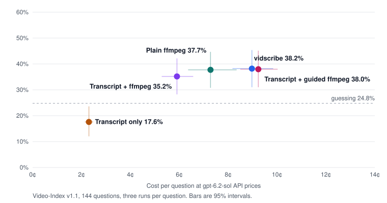

# Benchmark: vidscribe against plain ffmpeg

vidscribe gives an agent two things. The first is a transcript of the speech. The second is a set of commands that show the picture: overview sheets, `--at`, and `--scan`. This page tests each one against the obvious alternative, which is an agent that runs `ffmpeg` on the video file itself.

The results:

- **The picture commands did not beat plain `ffmpeg`.** On a public benchmark, an agent with vidscribe scored 38.2% and an agent with only `ffmpeg` scored 37.7%. vidscribe cost 23% more per question.
- **The transcript helped when the answer was spoken.** On 12 long talks, an agent with only `ffmpeg` scored 54% on the questions about what was said. Every setup with a transcript scored 100%. On the public benchmark, where few answers are spoken, the transcript did not help.
- **A guidance file for `ffmpeg` cost more and scored the same.** The agent looked at more frames. The score did not move by an amount these tests can detect.

Every run used one agent and one model: Codex CLI 0.169.0 with `gpt-6.2-sol` at medium reasoning effort. Treat the results as one data point.

## The five setups

| Setup | What the agent gets |
|---|---|
| Transcript only | vidscribe's transcript. No video file. |
| Plain ffmpeg | The video file. The prompt says that `ffmpeg` and `ffprobe` are installed. |
| Transcript + ffmpeg | The video file and vidscribe's transcript, as `.txt` and `.srt`. |
| Transcript + guided ffmpeg | The same files, plus a seven-step guidance file. The steps cover contact sheets of the whole video, full-size frames, crops, and 8 frames per second for motion. |
| vidscribe | The output of `vidscribe video.mp4`, the skill in [`skill/SKILL.md`](../skill/SKILL.md), and the `--at` and `--scan` commands. |

Each question ran in a new session. The session could read only its own folder and had no web access.

## Public benchmark: Video-Index v1.1

[Video-Index v1.1](https://github.com/Espere-1119-Song/Video-Index) is a set of 144 multiple-choice questions drawn from 33 video benchmarks ([Song et al., 2026](https://arxiv.org/abs/2610.00960)). Its authors removed the questions that the strongest agents all solved, so the set is hard. 78 of the questions are about silent clips. Guessing scores 24.8%.

Each setup answered every question three times.

| Setup | Accuracy (95% interval) | Cost per question | Seconds per question |
|---|---:|---:|---:|
| vidscribe | 38.2% (31.0 to 45.4) | $0.090 | 73.5 |
| Transcript + guided ffmpeg | 38.0% (31.0 to 45.1) | $0.092 | 80.2 |
| Plain ffmpeg | 37.7% (30.8 to 44.7) | $0.073 | 42.4 |
| Transcript + ffmpeg | 35.2% (28.2 to 42.1) | $0.059 | 70.3 |
| Transcript only | 17.6% (12.0 to 23.6) | $0.023 | 49.2 |

The next table compares two setups on the same questions. Four comparisons were chosen before the run.

| Comparison | Accuracy, in points | Cost per question |
|---|---:|---:|
| vidscribe minus plain ffmpeg | +0.5 (−4.9 to +5.8) | +$0.017 (+0.010 to +0.023) |
| Transcript + ffmpeg minus vidscribe | −3.0 (−7.2 to +0.9) | −$0.031 (−0.036 to −0.026) |
| Guided ffmpeg minus unguided ffmpeg, both with a transcript | +2.8 (−1.4 to +6.9) | +$0.033 (+0.029 to +0.037) |
| Transcript + ffmpeg minus plain ffmpeg | −2.5 (−7.6 to +2.5) | −$0.014 (−0.021 to −0.007) |

Every accuracy interval includes zero. The intervals are about 5 points wide on each side, so this test cannot show a smaller difference in either direction. The cost differences are clear.

The setups with a transcript took 28 to 38 seconds longer per question than plain `ffmpeg`. The extra time is the vidscribe run that makes the transcript.

### The transcript did not help on long videos with speech

On the first 100 questions, the setups with a transcript led plain `ffmpeg` by about 15 points on videos that have speech and run longer than 10 minutes. That pattern was found after looking at the results, so it needed a check on new questions. The check was written down before the last 44 questions ran.

| Questions | Count | Transcript + ffmpeg minus plain ffmpeg | vidscribe minus plain ffmpeg |
|---|---:|---:|---:|
| First 100 | 24 | +15.3 (0.0 to +31.9) | +13.9 (−1.4 to +30.6) |
| Last 44 | 10 | −23.3 (−50.0 to 0.0) | −26.7 (−50.0 to −6.7) |
| All 144 | 34 | +3.9 (−9.8 to +18.6) | +2.0 (−12.7 to +16.7) |

The lead reversed on the new questions. The early pattern was noise.

## Long talks: 12 videos, 108 questions

Video-Index has few questions like the ones vidscribe was built for: a long talk, and a question about something said or shown in it. This second set is that case. The author of vidscribe built it, so give it less weight than the public benchmark.

The set has 12 YouTube videos of 39 to 111 minutes: keynotes, lectures, conference talks, a documentary, a podcast, and a cooking show. It has 108 questions with short written answers:

- 48 questions about something on screen at a moment that the question names through speech.
- 12 questions that need both the speech and the picture.
- 12 questions that the speech alone answers.
- 36 hard questions about something on screen at a moment that the speech never names.

An AI agent wrote the questions and the reference answers. A separate `gpt-6.2-sol` session graded each answer 1, 0.5, or 0 without knowing the setup. A blind second scoring of 20 answers disagreed with 2 of the grades. Each setup answered every question once.

| Setup | Score | Speech questions (12) | Hard questions (36) | Cost per question |
|---|---:|---:|---:|---:|
| vidscribe | 95.8% | 100% | 100% | $0.083 |
| Transcript + ffmpeg | 95.4% | 100% | 94.4% | $0.059 |
| Transcript + guided ffmpeg | 95.4% | 100% | 97.2% | $0.103 |
| Plain ffmpeg | 89.8% | 54.2% | 97.2% | $0.107 |

The intervals below resample whole videos, because questions about one video are not independent.

| Comparison | Score, in points |
|---|---:|
| Transcript + ffmpeg minus vidscribe | −0.5 (−3.2 to +2.3) |
| Plain ffmpeg minus vidscribe | −6.0 (−10.6 to −1.9) |
| Guided ffmpeg minus unguided ffmpeg, both with a transcript | 0.0 (−2.8 to +2.8) |

With the same transcript, plain `ffmpeg` matched vidscribe's picture commands and cost 30% less. Without a transcript the score fell 6 points, and the speech questions account for almost all of the loss. Plain `ffmpeg` still scored 54% on the speech questions because the model can listen to short audio clips. It did so in 7 of the 12 speech sessions.

Two cautions apply to this table. The scores are near 100%, so the set cannot separate setups that are close. In the hard column, the gap between 100% and 94.4% is two questions.

Speech recognition took about 155 seconds per video on an M5 Pro Mac mini. The agent then took about 29 seconds per question with vidscribe or with transcript + ffmpeg, 57 seconds with the guidance file, and 68 seconds without a transcript.

## What the results mean for vidscribe

Use vidscribe to fetch a video and transcribe it. For the picture, an agent that can run `ffmpeg` did as well without the picture commands in both tests, at a lower cost. The picture commands stay in the tool. These tests give no reason to prefer them over `ffmpeg`.

## Limits

- **One agent, one model, one effort level.** A model that knows `ffmpeg` less well may need the picture commands more.
- **Wide intervals.** 144 questions and three runs give about 7 points of uncertainty on a score and about 5 on a difference.
- **The long-talk set is small.** It has 12 videos, AI-written questions, an AI grader, and scores near the top of the scale.
- **Costs are list prices.** Each request's token counts are priced at the `gpt-6.2-sol` API rates: $2.00 per million input tokens, $0.10 per million cached input tokens, and $10.00 per million output tokens. The sessions ran on a ChatGPT subscription.
- **Seconds are rough.** The machine was under load, and the setups with a transcript are charged for the whole vidscribe run, overview sheets included.
- **One unexplained result.** On the 78 silent questions, transcript + ffmpeg scored 6 points below plain `ffmpeg` (−11.5 to −0.9), although the transcript of a silent clip is empty. Nobody planned that comparison, and the one unplanned pattern that was checked on new questions reversed.
- **Dates and versions.** The runs took place on 21 and 22 November 2026 with vidscribe at commit `7a119b4`.

## The earlier README number

Until this page, the README reported 15% for a transcript-only agent and 96% for vidscribe on 156 questions. Those runs told the agents not to run `ffmpeg`, and the baseline had no way to see the picture. The numbers show that an agent that sees the video beats one that does not. They do not compare vidscribe with plain `ffmpeg`, which is the comparison on this page.

The questions, grades, prompts, and scripts from those runs are in [the last commit that has the `eval/` folder](https://github.com/SamuelZ12/vidscribe/tree/7a119b4786de1198ab533ebe85c0314ae35d90d7/eval). The 108 long-talk questions on this page come from that folder. The method is in [measurements.md](measurements.md).

## Data and code

The page reports scores only. It includes no videos, questions, or answers from Video-Index, whose items keep the licences of their source benchmarks. The runner that produced these numbers is not public.
